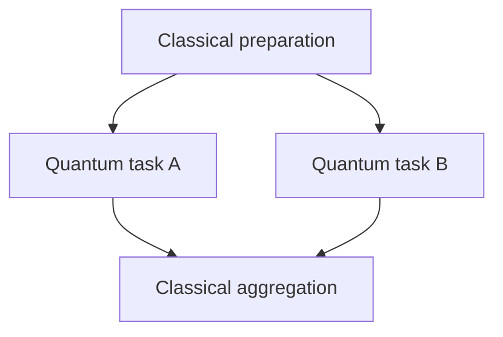

# ResearchOS TECT — Utility-Scale Quantum Systems Design and Evaluation

Independent research workspace aligned with DARPA QBI goals for utility-scale fault-tolerant quantum computing, supporting system design studies, quantum-classical workflow evaluation, scenario-based resource planning, and evidence-linked assessment of QBIT-specific research concepts.

This is a standalone systems-planning repository, independent of the Quantum Benchmarking, SynQuaNon and heterogeneous integration projects. TECT is retained as the project identifier without an assumed expansion.

## Implemented workflow

- Validated quantum-classical directed acyclic graphs (DAGs), including cycle, unknown dependency and duplicate checks.
- Deterministic single-QPU scheduling with dependency constraints and concurrent classical work.
- Multiple architecture scenarios, resource overhead assumptions, cycle-time sensitivity, logical/physical capacity checks and conditional failure-budget arithmetic.
- Explicitly declared baseline/quality comparisons. Missing quality, baseline, physical capacity or topic selection remains visible.
- Requirement-to-evidence mapping and a qualitative risk register; supported owner assessments require evidence references.
- SHA-256 evidence checks, captured portable bundles, JSON/CSV/Markdown exports and reproduction verification.

This software does not execute quantum circuits or control hardware. It does not implement fault-tolerant compilation, architecture-specific decoding/factory scheduling, or economic utility validation. Results are declared-assumption planning estimates, not evidence of quantum advantage, physical feasibility or a utility-scale computer. No DARPA affiliation, award, endorsement, eligibility or submission is claimed.

## Quick start

Python 3.10 or newer. No third-party runtime dependencies. From the repository root:

```bash
python -m researchos_systems validate examples/synthetic-system.json
python -m researchos_systems run examples/synthetic-system.json --output runs/demo
python -m researchos_systems verify runs/demo
python -m researchos_systems report runs/demo
python -m unittest discover -s tests -v
```

Optional installation enables `researchos-systems`:

```bash
python -m pip install .
researchos-systems --help
```

The fictional example has two quantum tasks sharing one QPU:



Dependencies permit both quantum tasks after preparation, but the scheduler serializes them on the single QPU. Reference and slower-cycle scenarios estimate 4.7 s and 7.7 s respectively. The reference unconstrained critical path is 3.6 s. A third scenario intentionally exceeds declared logical and physical capacity; its hypothetical schedule is retained for diagnosis and its baseline ratio is suppressed. All timings, resource factors, quality declarations and baseline values are synthetic fixtures.

## Create a systems study

1. Copy the example and assign a unique ID, owner, hypothesis, workload reference and honest input basis.
2. Define classical tasks with durations and quantum tasks with logical qubits, depth, shots and setup time. Link tasks by `depends_on` IDs.
3. Define one or more architecture scenarios with traceable overhead, cycle time, capacity and per-location error assumptions.
4. Add quality and matched classical baseline declarations only when their scope is justified. The scheduler records these declarations; it does not validate application quality.
5. Record owner-defined or topic-specific requirements with exact source references, assessments, evidence IDs and rationale. Add risks and mitigations. Populate `qbit` only after selecting a specific topic and checking its instructions.
6. Put authorized evidence files below the record directory, calculate digests with `researchos-systems hash <file>`, and declare their IDs, paths and descriptions.
7. Validate, run into a new output directory, verify, and review the assumptions, scenario gaps and missing data.

Experimental input records require evidence references for workflow/scenario inputs and any quality/baseline declarations. This enforces traceability, not scientific validity. Local run bundles are ignored by Git. Keep credentials and unpublished partner data out of this public repository.

## Bundle output

| File | Purpose |
| --- | --- |
| `record.json` | Exact original study bytes |
| `results.json` | Scenario schedules, resource/capacity checks, declared comparisons, requirements and risks |
| `schedule.csv` | Start/end/duration for each task and scenario |
| `report.md` | Scenario summary, owner assessments, missing data and limitations |
| `evidence/0000.bin`, … | Captured original evidence bytes |
| `manifest.json` | File digests, evidence mapping and Python version |

Existing output directories are rejected. The verifier checks hashes, evidence-to-record consistency, and reproduction of results/report/CSV. Identical inputs under the same runner/runtime yield identical bundles. Checksums are not signatures or proof of authenticity; independent provenance review remains necessary.

## Documentation

- [Record contract](docs/RECORDS.md)
- [Scheduling and resource model](docs/MODEL.md)
- [Research roadmap](docs/RESEARCH_PLAN.md)
- [QBI/QBIT source context](docs/SOURCES.md)
- [Contributing](CONTRIBUTING.md)

CI installs the package and runs tests plus the full example workflow across Python 3.10–3.13, with synthetic bundle artifacts. The existing [license](LICENSE) is preserved.

## Interactive browser app

The `web/` directory contains a local-first study builder, architecture scenario editor, one-QPU schedule timelines, comparison matrix, requirements and risk registers, evidence checksum tools, and JSON/CSV/Markdown exports. Evaluation runs in a browser worker. Serve with `python -m http.server 8000 --directory web` and open `http://localhost:8000`. Run web checks with `node web/tests/model.test.mjs`. Use localhost or HTTPS for modules, workers and Web Crypto.

Studies stay in the current browser and origin; export regularly. No GitHub, CLI or cross-device synchronization is configured. Study JSON exports are compatible with the CLI. Browser results and reports are summaries, not complete CLI evidence bundles. Selected files are hashed locally; only declarations are stored, and original files must be retained separately. Imported/reloaded records do not re-verify evidence bytes. The builder creates synthetic/simulation studies; experimental studies can be imported with their evidence declarations. Editing an imported experimental study as a new template changes its input basis to simulation for explicit review.

The web model is checked against the Python scheduler across multiple study variants. Derived integers beyond JavaScript safe precision are rejected with a direction to use the Python CLI. Floating-point boundary differences can still occur across runtimes.

Private hosted app: https://researchos-tect-quantum-systems.troturn31.chatgpt.site
